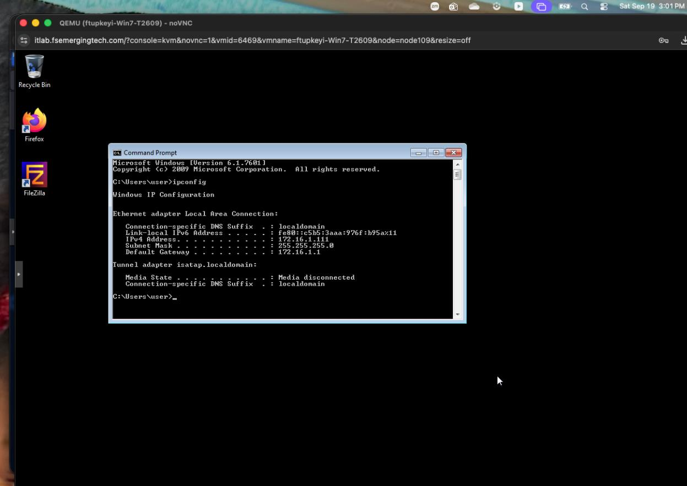
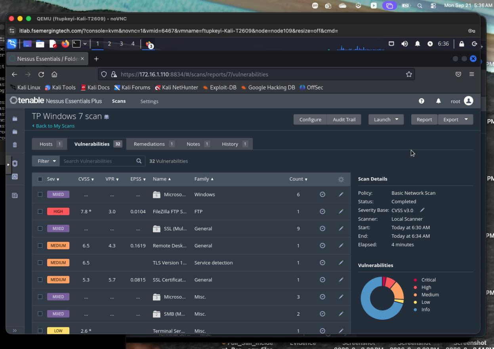
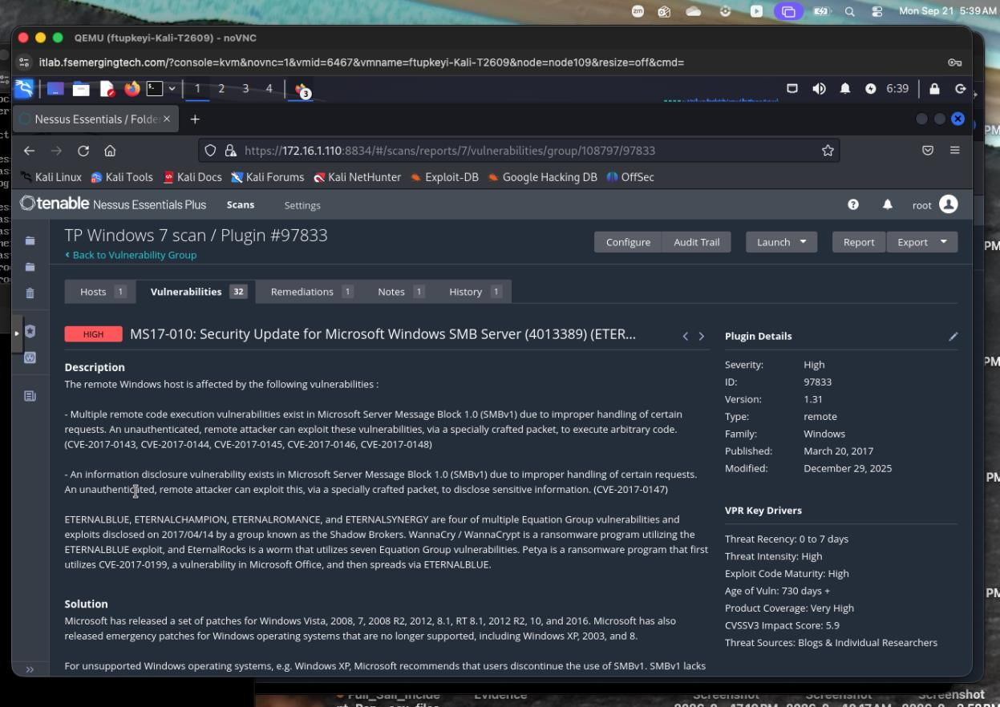

# Lab 3: Windows 7 Vulnerability Assessment with Nessus

**Francisca Tupkeyi | Guided security lab**

[Collection overview](../README.md) · [Lab 4](../04-exploitation-testing/README.md)

## Objective

Identify the Windows 7 target, run a Nessus network assessment, and review the evidence behind a reported SMB vulnerability.

## Host identification and scan

The Windows `ipconfig` output records target address `172.16.1.111`. I configured a Nessus scan for the Windows 7 VM and reviewed the completed results.

The completed Basic Network Scan reports **32 entries** in the Vulnerabilities view. Scanner entries can include informational results and grouped findings; this number should not be presented as 32 independently confirmed exploitable flaws.

## SMB finding review

I opened Nessus plugin **97833**, whose title identifies MS17-010, the Microsoft Windows SMB Server security update. The screenshot labels the finding High and describes remote-code-execution and information-disclosure issues affecting SMBv1. It lists multiple CVEs, so the entire finding should not be treated as one CVE or as proof that a particular exploit succeeded.

## Result and limits

The evidence supports a completed remote assessment and review of a reported MS17-010 exposure. Scanner output alone does not prove code execution or compromise. The source record includes a prompt to review CVSS metrics, but it does not contain a completed per-CVE analysis; no unverified metric table has been added here.

## Skills demonstrated

- Identify a target using host network configuration.
- Configure and review a Nessus network scan.
- Read plugin descriptions, severity, affected components, and proposed solutions.
- Separate scanner detections from manually validated exploitation.

## Next steps

For remediation validation, I would review installed updates and SMB configuration on the endpoint, apply the appropriate changes, and repeat assessment under comparable conditions. This walkthrough records the baseline assessment rather than completed patch verification.

## Evidence source

Three selected screenshots from my Lab 3 record. The duplicate uploaded PDF was byte-for-byte identical and was not published separately.
