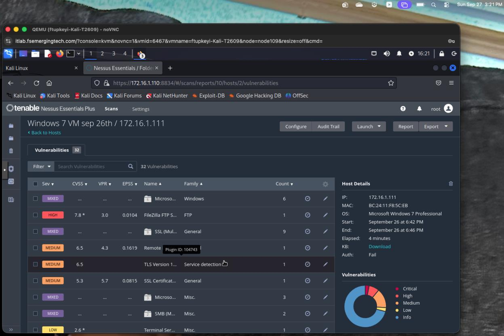
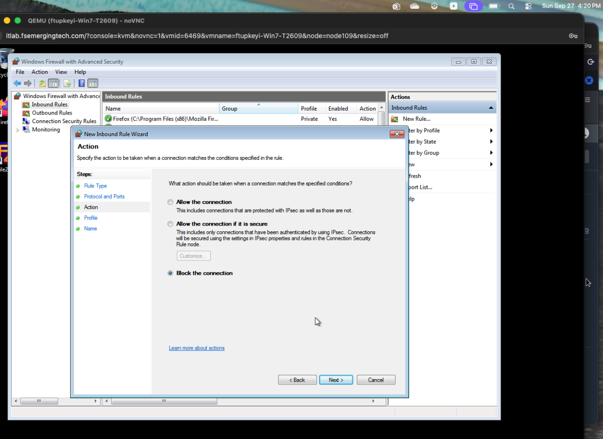
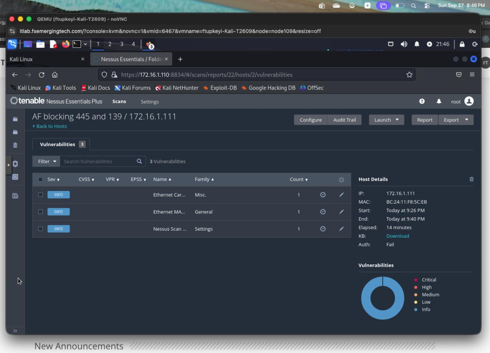
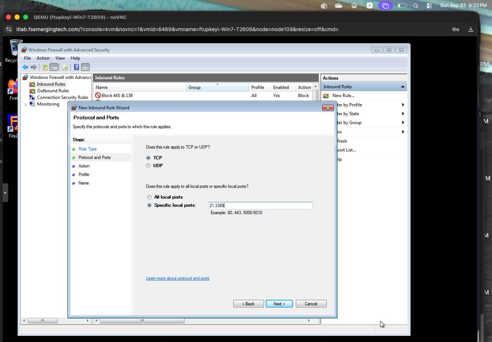
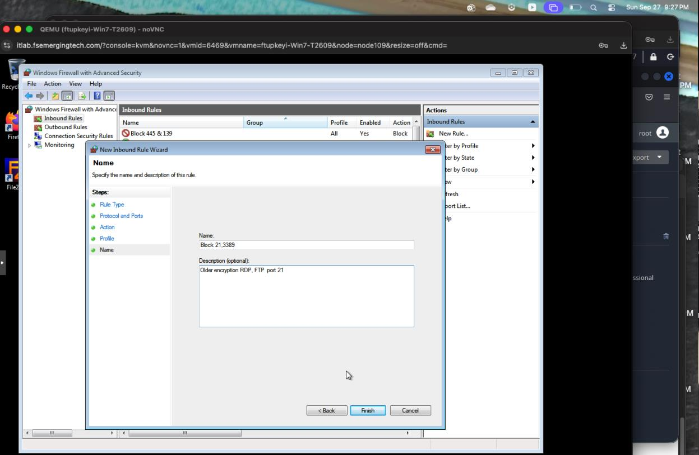
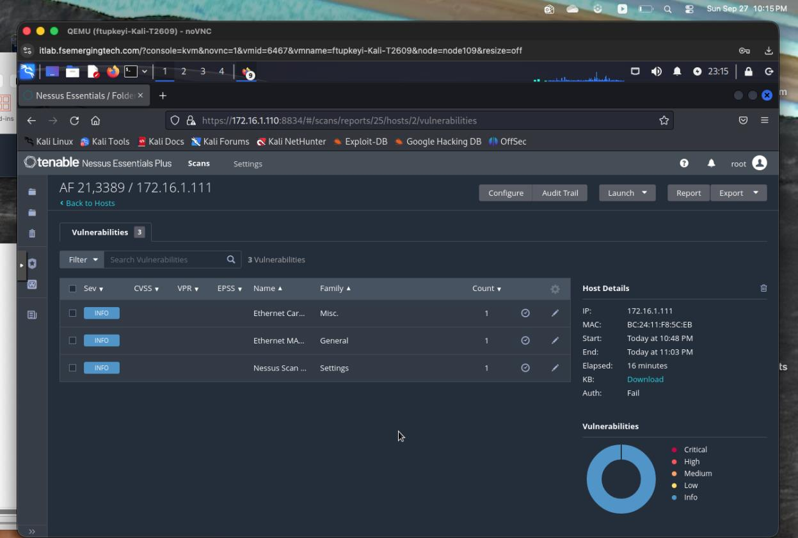

# Lab 6: Windows Firewall Exposure Reduction and Scan Validation

**Francisca Tupkeyi | Guided security lab**

[Collection overview](../README.md) · [Lab 3 baseline assessment](../03-nessus-assessment/README.md)

## Objective

Compare Nessus results before and after enabling Windows Firewall and adding inbound block rules on the Windows 7 training target. The central question is whether remote exposure changed, not whether fewer scan findings prove that software was patched.

## 1. Establish the baseline

The baseline host view for `172.16.1.111` shows **32 Nessus entries**, including non-informational findings. The screenshot also shows **Auth: Fail**, so it is not evidence of a successful credentialed assessment.

## 2. Enable the firewall and review exposure

My source record documents enabling Windows Firewall and a subsequent scan with three entries. The later scans below likewise show three informational entries. This demonstrates reduced remote visibility under the tested conditions; it does not establish that all underlying flaws disappeared.

## 3. Configure SMB-related inbound restrictions

I worked through an inbound TCP block rule intended for ports **445 and 139**, applying it across Domain, Private, and Public profiles. The action and profile selections are shown below.

One intermediate port-entry screenshot in the original record reads `445,139a`, with a stray character. It is not proof of a valid saved port list. A later rule list shows an enabled block rule named “Block 445 & 139,” but a rule name alone does not verify its actual port properties. A stronger follow-up would capture the saved rule's Protocols and Ports tab and test reachability directly.

The scan labeled “AF blocking 445 and 139” lists only **three informational entries**, with Auth: Fail. The previously reported SMB findings are not displayed in that view. This supports reduced scanner visibility rather than completed patch remediation.

## 4. Add FTP and RDP restrictions

I configured an additional inbound TCP rule for ports **21 and 3389**, corresponding to the FTP and RDP exposure reviewed in the lab. The wizard's port field and descriptive rule name are visible in the evidence.

The final scan again shows three informational entries. Because the count was already three at an earlier stage, the final screenshot does not demonstrate an additional numerical reduction caused specifically by the FTP/RDP rule.

## Findings and interpretation

| Stage | Recorded observation | What it supports |
| --- | --- | --- |
| Baseline | 32 scanner entries | Services and findings were remotely visible |
| Firewall enabled | Source record shows three entries | Remote visibility changed |
| SMB rule stage | Three informational entries; SMB findings not displayed | Reduced detectability from this scanner vantage point |
| Additional FTP/RDP rule stage | Three informational entries | No further count reduction demonstrated |

**Blocking traffic reduces exposure; it does not remove vulnerable code.** Credentialed scan authentication was unsuccessful in the displayed results, limiting conclusions about the target's patch state.

## What I learned and would verify next

- Compare scan scope, authentication status, and finding severity rather than only totals.
- Separate risk mitigation through filtering from software remediation.
- Verify saved rule properties instead of relying on descriptive names.
- Test TCP reachability and required application functionality after rule changes.
- Use endpoint update inventory or a successful credentialed assessment to validate patch status.

## Evidence source

Six screenshots were selected from my Lab 6 record. Intermediate wizard screenshots and scan results are retained as evidence of the documented workflow, with limitations called out explicitly. No firewall or scanning actions were performed while publishing this walkthrough.
