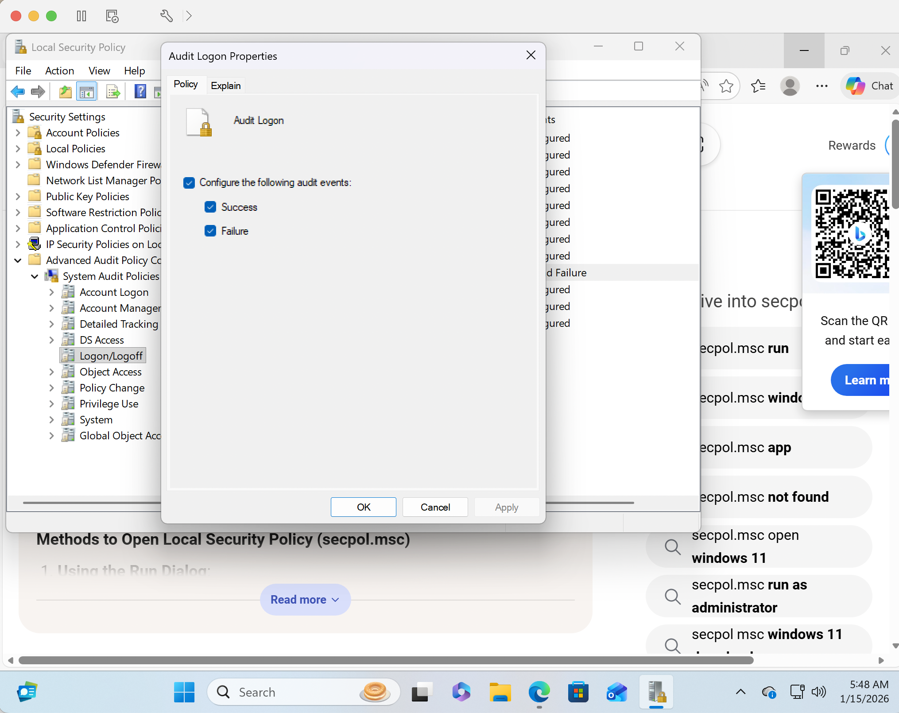
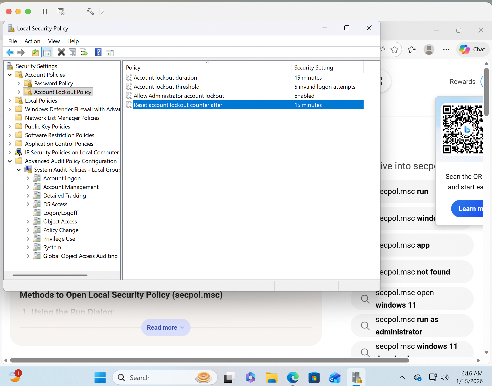

# Windows 11 Hardening and Auditing

[Back to the home lab](../README.md)

## Objective

Configure authentication controls and logon auditing on WIN11-LAB1 to support later security monitoring and investigation.

## Environment

Windows 11 Pro ARM running in VMware Fusion on an Apple Silicon Mac. This is the Windows 11 home lab described in the repository overview.

## Logon auditing

In Advanced Audit Policy Configuration, navigate to:

**System Audit Policies > Logon/Logoff > Audit Logon**

Enable both **Success** and **Failure**.

These settings record successful and failed logon activity for review. Investigating suspicious authentication requires examining the resulting events and their context.

## Account lockout configuration

| Setting | Recorded value |
| --- | --- |
| Account lockout threshold | 5 failed attempts |
| Account lockout duration | 15 minutes |
| Reset account lockout counter after | 15 minutes |

## Current scope

The evidence documents policy configuration. A controlled failed-logon test and a review of the resulting Security events are next steps for validating monitoring behavior.
